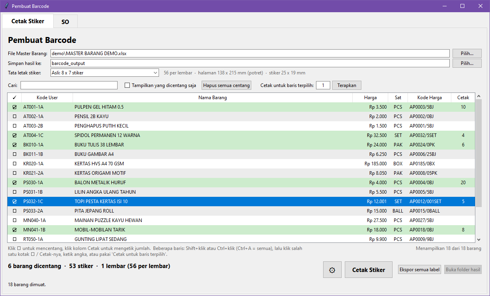
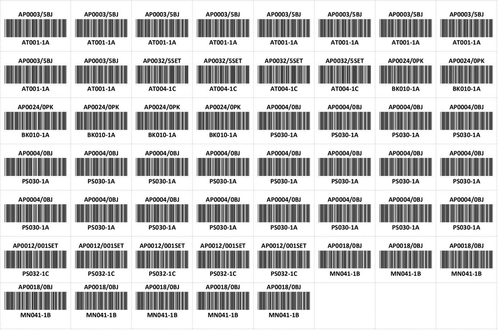
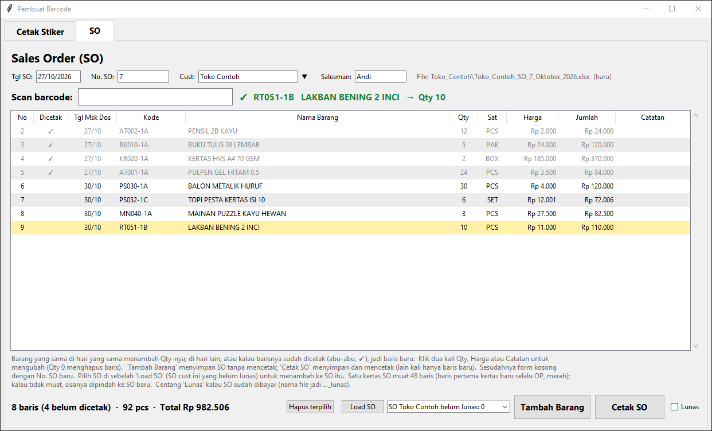
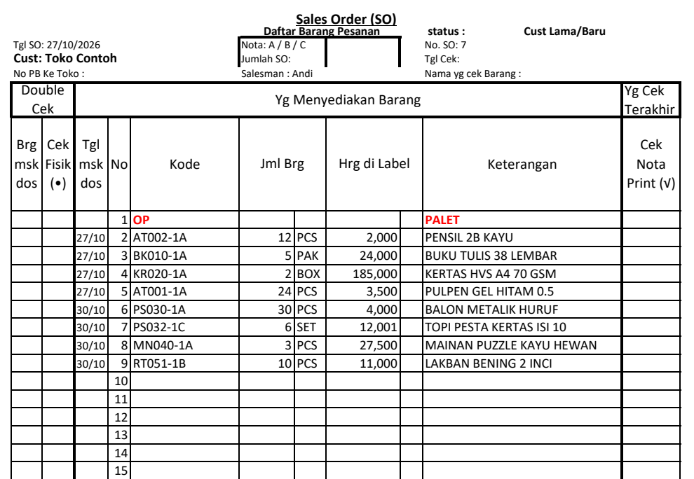

# Barcode & Sales Order Maker (Pembuat Barcode)

A Windows desktop app for a small wholesale shop in Indonesia. It does two everyday jobs:

1. **Barcode stickers**: pick items from the shop's item master (an Excel export from its accounting
   software) and print Code 39 barcode stickers on pre-cut sticker sheets.
2. **Sales orders (SO)**: scan item barcodes into a sales order for a customer and print it on the shop's
   own pre-printed Excel SO form, a few rows at a time, on the same sheet of paper.

The app is used daily in a real shop. This repository is a cleaned public copy: the shop name, staff names,
customers and item data are replaced with made-up demo data. The user interface is in **Bahasa Indonesia**,
as it is for the shop's staff.

## Screenshots

All screenshots use the made-up demo data.

**Cetak Stiker**: tick items and set how many stickers each one needs.



**The sticker sheet** it generates (the Word document, exported to PDF; shown turned upright, it prints
a quarter turn on the 8 x 7 die-cut sheet). Price code on top, Code 39 barcode, item code below.



**SO**: scanned rows for a customer. Grey rows with ✓ are already printed on the paper; the new rows below
them are the only ones the next "Cetak SO" prints.



**The SO form** filled in by the app (top part of the page; row 1 is the `OP` row for hand-written notes).



## Features

### Cetak Stiker (barcode stickers)
- Reads the item master from `.xls` or `.xlsx` and finds the columns by their header names
  (`Kode User`, `Nama Barang`, `Hrg. Jual 1`, `Sat.`), so extra columns in the export do not matter.
- Search, sortable columns, Ctrl/Shift multi-select and a per-item sticker count.
- Each sticker shows a **price code** (for example `AP0003/2SET` = Rp 3.200 per SET), a **Code 39 barcode**
  with Full ASCII support, and the item code.
- Generates a Word document with an exact-size table that matches the die-cut sticker sheet, then opens it
  in Word to print. A paper-size editor (click cells, set width/height in mm) adjusts the layout.
- Compensates for several Word layout quirks (cell padding, table indent, rotated text in vertical cells),
  measured from Word-exported PDFs.

### SO (sales orders)
- Scan with a USB barcode scanner, or type part of a code/name and pick from a live suggestion list.
- One SO per customer bill: an SO can stay open for days or weeks and is reloaded to add more items
  until the customer pays ("Lunas").
- **Prints only the new rows** at their exact positions, so the same SO paper goes back into the printer
  several times. Printed rows are locked (no delete or merge).
- SO numbers restart every month and are shared by all customers; they are derived from the file names,
  so several PCs on a shared folder do not clash.
- When the paper is full, the remaining rows move to a new SO that is saved immediately (keeps numbering
  in time order).
- Customer list with search and add/remove, a draft that survives closing the app, and an `OP` first row
  on every new form for hand-written notes.
- Output: `SO_output/<Cust>/<Cust>_SO_<No>_<Bulan>_<Tahun>[_lunas].xlsx`.

### Robustness
- Startup launcher catches any error (even import errors) and shows it in a message box plus a log file,
  because a windowed app has no console.
- `--selftest <master file>` checks Excel reading, sticker generation and SO writing/reading inside the
  built exe.
- `release.py` installs missing libraries, builds the exe with PyInstaller, runs the self-test and only
  then makes the zip for other PCs.

## Tech

- **Python 3** with **tkinter / ttk** (GUI)
- **openpyxl** (write and read the SO form, read `.xlsx`), **xlrd** (read `.xls`)
- **python-docx** (sticker sheets as Word documents), **Pillow** (barcode images)
- **PyInstaller** (single-file Windows exe)
- Microsoft Word and Excel are used only for printing (the files are opened with the default program).

## Run from source

```bat
pip install -r requirements.txt
python start_app.pyw
```

Or double-click `Barcode Maker.bat`.

With no Master Barang file chosen yet, the app loads the demo file `demo/MASTER BARANG DEMO.xlsx`
(18 made-up items), so you can try both tabs right away. Try scanning `AT001-1A` or `PS032-1C` in the SO tab.

Self-test without opening the window:

```bat
python start_app.pyw --selftest "demo/MASTER BARANG DEMO.xlsx"
```

The result is written to `selftest_result.txt`.

## Build the exe

```bat
python release.py
```

(or double-click `Buat Exe dan Zip.bat`). This installs any missing libraries and PyInstaller, builds
`Pembuat Barcode.exe`, runs the self-test and writes `Pembuat Barcode.zip` (exe + SO form + user guide).
`build_exe.bat` builds only the exe.

## Project layout

| File | Purpose |
|---|---|
| `barcode_app.py` | The whole app: Excel input, price codes, barcodes, sticker documents, SO logic and GUI |
| `start_app.pyw` | Launcher with error reporting and `--selftest` |
| `release.py` | Build, self-test and zip |
| `SO/Form SO (Sales Order).xlsx` | The printed SO form (template) |
| `demo/MASTER BARANG DEMO.xlsx` | Made-up item master in the same layout as the real export |
| `CARA PAKAI.txt` | User guide for the shop staff (Indonesian) |

## License

[MIT](LICENSE) © Vincent Soesanto
